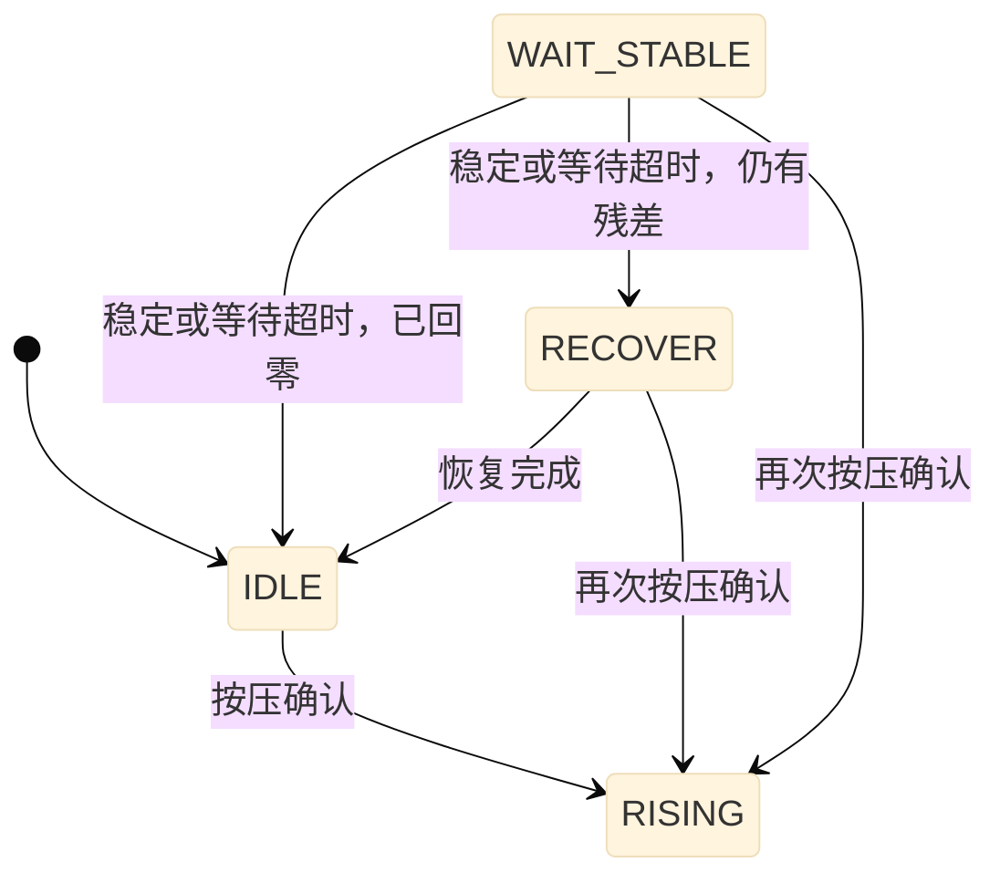
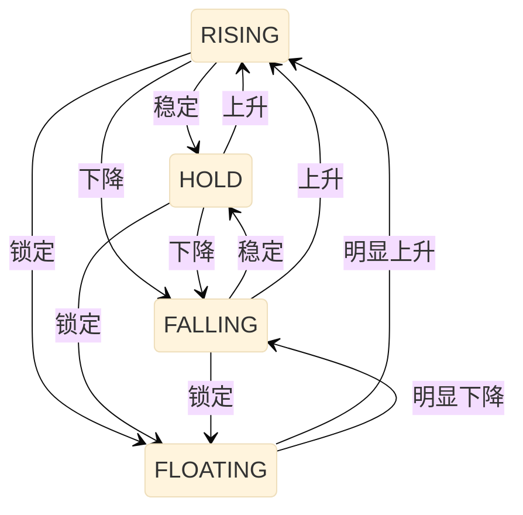
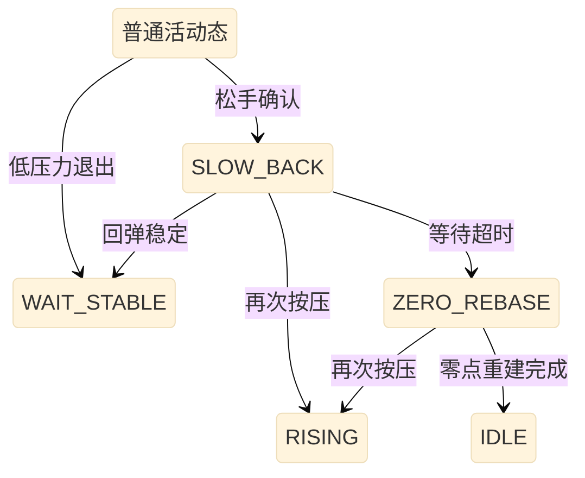

# 通道状态机设计说明

> 最新核对日期：2026-09-21。本文按当前工作区源码更新，包含延后FLOATING锁定、恢复等待上限和UART V21。核对对象是工作区实现，不代表板上固件已同步，也不代表全部材料、温度及跨重启场景已验证；整体功能见[当前实现](CURRENT_SYSTEM_CN.md)。
>
> 同步规则：修改状态机、状态枚举、状态通信字段、Signal 状态处理或与状态有关的 Baseline 行为时，应在同一次修改中同步本文。

## 1. 范围与源码入口

本文只描述每个传感器通道独立运行的状态机，不描述整体力矢量、电机或上位机测试流程的状态。

当前规则要点：首次按压从IDLE经3帧确认进入RISING；本轮峰值大于300 counts时，活动累计至少4秒且连续300 ms满足稳定条件才进入FLOATING；释放后的WAIT_STABLE最多等待320帧再进入回零/恢复判断。**FLOATING锁住的是Signal，不保证真实压力不变，也不保证换算牛顿值准确。** 第17节说明它与当前标定、写Flash及最近验证结果的关系，不增加第二套通道状态机。

| 源码 | 职责 |
|---|---|
| [channel_state_machine.c](channel_state_machine.c)、[channel_state_machine.h](channel_state_machine.h) | Raw 窗口、斜率、候选判定、确认计数、状态提交和复位。 |
| [sensor_algorithm.h](sensor_algorithm.h)、[device_variant.h](device_variant.h)、[Makefile](Makefile) | 状态编号、固定噪声、协议版本、变体和采样时基。 |
| [process_channel_sample.c](process_channel_sample.c) | 每帧 Signal、状态机、Baseline 的执行顺序。 |
| [sensor_algorithm.c](sensor_algorithm.c) | 状态机接入、Signal 锁定/清零、临时零点、快照和接触判定。 |
| [baseline_tracker.c](baseline_tracker.c)、[baseline_tracker.h](baseline_tracker.h) | 根据已提交状态执行 Baseline 滤波，不保存第二套状态。 |
| [channel_states.py](PY_SRIPT/algo_monitor/channel_states.py)、[main_window.py](PY_SRIPT/algo_monitor/main_window.py) | 上位机统一状态名称、分类和显示。 |
| [app_iic.c](app_iic.c)、[sensor_bus_slave.c](sensor_bus_slave.c) | 消费真实状态，生成接触 Active 位。 |

当前有 **9 个真实通道状态**；算法UART协议版本为 **21**。`RECOVER=7`和`WAIT_STABLE=8`已纳入唯一通道状态机，不是隐藏的Baseline阶段或上报替换值；V21标定表扩展没有新增状态或改变状态编号。

## 2. 状态定义及输出行为

枚举前缀均为 `SENSOR_ALGO_STATE_`。表内 Baseline 行为适用于已校准且没有活动抑制、切档冻结的正常帧。

| 数值 | 枚举后缀 | 上位机名称 | 含义 | Signal | Baseline | 接触 Active |
|---:|---|---|---|---|---|---:|
| 0 | `IDLE` | `IDLE` | 尚未确认有效按压，包含按压候选确认。 | 0 | 普通空闲约 0.005 跟随；压力越界时暂停 | 0 |
| 1 | `ACTIVE_RISING` | `RISING` | 压力明显上升。 | 正常滤波及补偿 | 冻结 | 1 |
| 2 | `ACTIVE_HOLD` | `ACTIVE` | 快慢变化稳定的短期保持。 | 正常滤波及补偿 | 冻结 | 1 |
| 3 | `ACTIVE_FALLING` | `FALLING` | 压力下降，尚未确认松手。 | 正常滤波及补偿 | 冻结 | 1 |
| 4 | `SLOW_BACK` | `SLOW BACK` | 已确认松手，屏蔽材料慢回弹。 | 0 | 冻结 | 0 |
| 5 | `ZERO_REBASE` | `ZERO REBASE` | 慢回弹超时后受控重建零点。 | 0 | 每帧约 0.02，RawDelta > 2 时暂停 | 0 |
| 6 | `ACTIVE_FLOATING` | `FLOATING` | 稳态锁定 Signal，补偿材料蠕变。 | 锁定进入时的值 | 冻结 | 1 |
| 7 | `RECOVER` | `RECOVER` | 已确认稳定，快速恢复 Baseline。 | 0 | 每帧约 0.02 跟随 Raw | 0 |
| 8 | `WAIT_STABLE` | `WAIT STABLE` | 已确认按压后的稳定等待，同时允许再次按压。 | 0 | 冻结 | 0 |

`ChannelState_IsIdleLike()` 仅包含 `IDLE/WAIT_STABLE/RECOVER`。下文“普通活动态”指 `RISING/HOLD/FALLING/FLOATING`。`SLOW_BACK` 和 `ZERO_REBASE` 虽然接触位为 0，但不属于 IdleLike。

状态 4 的旧名称是 `FAST_RELEASE`，当前语义为 `SLOW_BACK`；历史记录应结合当时固件版本解释。

## 3. 总体状态流

本节是 **Mermaid 文本图**，源代码直接保存在本 Markdown 的三个 `mermaid` 代码块中，没有单独的 PNG/JPG 源图片。为避免整张图缩到页面宽度后字太小，按流程拆成三张图，基础字号设为 **20 px**；完整条件放在图下表格中。

图中 K 单位为 `%/s`，压力、局部增量和误差单位为 counts。表中条件均受第 7～9 节的判定优先级约束，不表示每条箭头可以同时触发。

### 3.1 空闲、稳定等待与基线恢复



| 图中条件 | 实际判据 |
|---|---|
| 按压确认 | IDLE 中 `Pressure > 12` 且 `FastRawSlope >= 20 count/s` 连续 3 帧。 |
| 再次按压确认 | WAIT_STABLE/RECOVER 中相对恢复局部低点的增量 `> 12`，且 `FastRawSlope >= 80 count/s` 连续 3 帧。 |
| 稳定或等待超时，仍有残差 | WAIT_STABLE 中相邻帧 `abs(RawDelta) <= 2` 连续80帧，或该状态累计达到320帧；此时 `abs(Raw-Baseline) > 1` 进入RECOVER，不要求残差低于12。再次按压判定优先。 |
| 稳定或等待超时，已回零 | 同上稳定或超时条件，但 `abs(Raw-Baseline) <= 1` 时进入IDLE。 |
| 恢复完成 | RECOVER 中 `abs(Raw-Baseline) <= 1`。 |

**首次按压直接走 IDLE → RISING。** IDLE 中压力越界时立即暂停 Baseline 更新，真实状态仍保持 IDLE；按压条件连续 3 帧后才进入 RISING，不经过 WAIT_STABLE，也不等待 80 帧。未确认扰动退回门槛内后，当帧恢复普通 IDLE 跟随。

WAIT_STABLE/RECOVER 只用于已确认按压后的恢复。恢复残差不再作为再次按压的压力；2 counts 窗口波动既可以参与稳定确认，也不可能单独越过“局部增量 >12 且斜率 ≥80”的再次按压门槛。再次按压仍须经 RISING 才可能进入 FLOATING。

### 3.2 按压期间的四种活动状态



| 图中条件 | 实际判据 | 连续确认 |
|---|---|---|
| 稳定 | `abs(FastK) <= 15` 且 `abs(SlowK) <= 5`。 | 3 帧 |
| 上升 | `FastK >= +20`。 | 3 帧 |
| 下降 | `FastK <= -30`，或 Slow 窗口已满且 `SlowK <= -8`。 | 3 帧 |
| 锁定 | 本轮峰值 >300 counts 时活动至少4秒，否则至少1秒；`abs(FastK) <= 15` 且 `abs(SlowK) <= 10`。 | 本轮压力峰值 >300 counts 时连续 300 ms；否则 3 帧 |
| 明显上升 | `FastK >= +80`。 | 50 ms 对应帧数 |
| 明显下降 | `FastK <= -100`。 | 50 ms 对应帧数 |

松手、低压力退出优先于本图；普通“锁定”优先于“下降”。Slow 窗口未满时，Slow 稳定条件暂按成立处理。HOLD 在上位机显示为 ACTIVE。50 ms 在 160 Hz 下为 8 帧，在 250 Hz 下为 13 帧。

### 3.3 松手、慢回弹与再次按压

图中“普通活动态”只是 `RISING/HOLD/FALLING/FLOATING` 的合并展示，不是新增固件状态。



| 图中条件 | 实际判据 |
|---|---|
| 松手确认 | 300/1000 counts 压力分段的跌幅、Fast K 和持续帧数全部满足，详见第 8 节；确认完成后立即提交。 |
| 低压力退出 | 第 7.3 节低压力条件连续满足 16 帧。 |
| 回弹稳定 | `Pressure <= 10` 且 `abs(FastRawSlope) <= 20 count/s` 连续 400 ms 对应帧数。 |
| 等待超时 | SLOW_BACK 达到 30 秒对应帧数，且没有先命中再次按压或回弹稳定。 |
| 再次按压 | 相对局部 Raw 低点的增量 `> 12`，且 `FastRawSlope >= 80 count/s` 连续 3 帧。 |
| 零点重建完成 | `abs(Raw-Baseline) <= 10` 且 `abs(FastRawSlope) <= 20 count/s` 连续 400 ms 对应帧数。 |

SLOW_BACK 退出后进入 WAIT_STABLE，继续执行图 3.1 的稳定等待；ZERO_REBASE 完成后直接进入 IDLE。

三张图共用的复位规则：未校准或 `suppress_activity=true` 时，任意状态通过统一入口进入 IDLE；初始化、重新校准走 `ChannelState_Reset()`。

## 4. 输入、压力和固定噪声

### 4.1 每帧输入

| 字段 | 类型 | 当前含义 |
|---|---|---|
| `raw` | `uint16_t` | 当前V20/V21路径直接使用CapSense硬件Raw计数；不经过旧Norm/仿射归一化。通道映射见 `main.c::Sensor_ReadRawCounts()`。 |
| `baseline` | `uint16_t` | 本帧状态判定之前的 Baseline 整数值。 |
| `noise` | `uint16_t` | 接口兼容字段；状态判断不使用传入值，统一采用固定噪声 1。 |
| `calibrated` | `bool` | 是否完成全局校准。 |
| `suppress_activity` | `bool` | 单通道重新校准等流程是否抑制活动。 |
| `autorange_transition_active` | `bool` | 自动量程过渡期间保持当前状态。 |
| `autorange_transition_finished` | `bool` | 过渡结束首帧重建斜率窗口。 |

### 4.2 压力与峰值

本状态机的`Pressure/PeakPressure`单位是 **counts**，不是压力计的N；300/1000 counts分界也不是固定的牛顿压力点。Fast/Slow K是Raw变化的归一化斜率（%/s），与传感器标定表的分段K（N/count）是不同量。

```text
Pressure = max(Raw - ActivationBaseline, 0)
PeakPressure = 本轮观察到的最大 Pressure
Noise = SENSOR_ALGO_FIXED_NOISE = 1 count
PressureOn = max(Noise × 3, 12) = 12 counts
PressureOff = max(Noise × 2, 10) = 10 counts
NormalizationFloor = max(Noise × 10, 20) = 20 counts
NormalizationReference = max(PeakPressure, 20)
```

- `IDLE/WAIT_STABLE/RECOVER` 每帧分类前同步 `ActivationBaseline` 为当前 Baseline；普通活动态及两个回弹恢复态保持本轮参考。
- 每帧分类前更新峰值；提交后的状态属于 IdleLike 时，清零峰值、活动累计时间和 K 遥测。
- `SLOW_BACK/ZERO_REBASE → RISING` 正式提交后，使用当前 Baseline 重建活动参考、峰值和归一化分母，活动累计时间归零。
- 普通活动态之间切换不清零活动累计时间；切档过渡及结束首帧不推进活动或状态计时。
- `Pressure > 12` 才越过激活门槛，`Pressure <= 10` 可参与低压力退出确认。按压前的基线冻结也使用同一激活门槛，由状态机统一计算。

## 5. 时基、窗口和 K

### 5.1 变体时基

| 项目 | INDEX_FINGER | THUMB / PINKY |
|---|---:|---:|
| 通道数 | 8 | 5 |
| 标称采样率 | 160 Hz | 250 Hz |
| 单帧时间 | 6.25 ms | 4 ms |
| Fast 窗口（100 ms） | 16 点 | 25 点 |
| Slow 窗口（1 s） | 160 点 | 250 点 |
| 普通候选确认（固定 3 帧） | 18.75 ms | 12 ms |
| 低压力退出确认（固定 16 帧） | 100 ms | 64 ms |
| WAIT_STABLE 确认（固定 80 帧） | 500 ms | 320 ms |
| WAIT_STABLE 最长等待（固定320帧） | 2 s | 1.28 s |
| FLOATING 最短活动时间（本轮峰值 ≤300 counts，1 s） | 160 帧 | 250 帧 |
| FLOATING 最短活动时间（本轮峰值 >300 counts，4 s） | 640 帧 | 1000 帧 |
| FLOATING 入态稳定确认（本轮压力峰值 >300 counts） | 48 帧 / 300 ms | 75 帧 / 300 ms |
| FLOATING 退出 / 小压力松手确认（50 ms 向上取整） | 8 帧 / 50 ms | 13 帧 / 52 ms |
| 回弹/零点重建稳定确认（400 ms） | 64 帧 | 100 帧 |
| SLOW_BACK 超时（30 s） | 4800 帧 | 7500 帧 |
| K 遥测更新（固定 8 帧） | 50 ms，20 Hz | 32 ms，31.25 Hz |

`Makefile` 默认 `FINGER_TYPE=INDEX_FINGER` 并显式传入 `DEVICE_FINGER_TYPE`；当前 `device_variant.h` 在没有构建宏时的后备值是 THUMB。判断实际变体应看构建参数，不能只看头文件注释或目录名称。

### 5.2 滑动回归与单位

```text
x = 0, 1, ..., N-1
Σx = N(N-1)/2
D = N×Σx² - (Σx)² = N²(N²-1)/12
SlopePerSample = (N×Σxy - Σx×Σy) / D
RawSlopePerSecond = SlopePerSample × SENSOR_ALGO_FRAME_RATE_HZ
NormalizedK(%/s) = RawSlopePerSecond / NormalizationReference × 100
K_x100 = NormalizedK × 100
```

回归使用滚动和、滚动加权和；常数按窗口点数在编译期计算。

| 窗口点数 N | Σx | 回归分母 D |
|---:|---:|---:|
| 16 | 120 | 5,440 |
| 160 | 12,720 | 54,611,200 |
| 25 | 300 | 32,500 |
| 250 | 31,125 | 325,515,625 |

每帧分类直接使用当前回归结果，不等待每 8 帧更新一次的遥测。遥测首次有效时立即计算，随后降频更新；`2000` 表示 `+20.00 %/s`，`-25000` 表示 `-250.00 %/s`。

正常处理时所有状态都维护 Raw 窗口，切档过渡例外。Fast 未填满时斜率分子为 0；复位后第 N 个样本加入后才能得到 Fast 回归结果。Slow 未填满时不参与 FALLING 判断，两个 Slow 稳定条件暂按成立处理。

IdleLike、未校准、活动抑制、切档过渡及过渡结束首帧的 K 遥测清零；`SLOW_BACK/ZERO_REBASE` 在正常处理时仍可输出 K。因此 K 为 0 不一定代表物理 Raw 完全静止。

## 6. 参数表

除注明外，下列宏位于 `channel_state_machine.c`，省略共同前缀 `CHANNEL_STATE_`。

| 宏后缀 | 当前值或定义 | 用途 |
|---|---|---|
| `SAMPLE_RATE_HZ` | `SENSOR_ALGO_FRAME_RATE_HZ` | 跟随变体时基。 |
| `DEBOUNCE_FRAMES` | 3 | 普通候选确认。 |
| `IDLE_CONFIRM_FRAMES` | 16 | 普通活动态低压力退出确认，最终提交 WAIT_STABLE。 |
| `BASELINE_STABLE_FRAMES` / `BASELINE_STABLE_DELTA` | 80 / 2 | WAIT_STABLE 连续帧数和 RawDelta 绝对值上限。 |
| `WAIT_STABLE_MAX_FRAMES` | 320 | WAIT_STABLE 最长持续帧数；噪声持续打断稳定确认时转入 RECOVER，避免永久冻结。 |
| `BASELINE_RECOVERED_ERROR` | 1 | WAIT_STABLE 直达 IDLE、RECOVER 结束的绝对误差。 |
| `PRESSURE_ON_MIN` / `PRESSURE_ON_NOISE_MULTIPLIER` | 12 / 3 | 激活门槛。 |
| `PRESSURE_OFF_MIN` / `PRESSURE_OFF_NOISE_MULTIPLIER` | 10 / 2 | 低压力退出门槛。 |
| `NORMALIZATION_MIN` / `NORMALIZATION_NOISE_MULTIPLIER` | 20 / 10 | K 归一化下限。 |
| `RISING_RAW_COUNTS_PER_SECOND_MIN` | 20 | IDLE 首次激活绝对斜率；也用于取消松手候选。 |
| `RISING_FAST_PERCENT_PER_SECOND_X100` | 2000 | 普通 RISING：Fast K ≥ +20 %/s。 |
| `FALLING_FAST_PERCENT_PER_SECOND_X100` | -3000 | 普通 FALLING：Fast K ≤ -30 %/s。 |
| `FALLING_SLOW_PERCENT_PER_SECOND_X100` | -800 | 普通 FALLING：Slow K ≤ -8 %/s。 |
| `FAST_STABLE_PERCENT_PER_SECOND_X100` | 1500 | Fast 稳定：绝对值 ≤ 15 %/s。 |
| `SLOW_STABLE_PERCENT_PER_SECOND_X100` | 500 | 普通 Slow 稳定：绝对值 ≤ 5 %/s。 |
| `FLOATING_SLOW_STABLE_PERCENT_PER_SECOND_X100` | 1000 | FLOATING 入态 Slow 稳定：绝对值 ≤ 10 %/s。 |
| `FLOATING_MIN_ACTIVE_FRAMES` | 1 s 对应帧数 | 本轮峰值 ≤300 counts 时的入态最短活动时间。 |
| `FLOATING_LOADED_MIN_ACTIVE_FRAMES` | 4 s 对应帧数 | 本轮峰值 >300 counts 时延迟锁定，保留末段小步补压。 |
| `FLOATING_ENTRY_CONFIRM_FRAMES` | 300 ms 对应帧数 | 本轮峰值超过300 counts时的连续稳定入态确认；小压力仍为3帧。 |
| `FLOATING_EXIT_RISING_FAST_PERCENT_PER_SECOND_X100` | 8000 | FLOATING 正向退出。 |
| `FLOATING_EXIT_FALLING_FAST_PERCENT_PER_SECOND_X100` | -10000 | FLOATING 负向退出。 |
| `FLOATING_EXIT_CONFIRM_FRAMES` | 50 ms 对应帧数 | FLOATING 到 RISING/FALLING 的专用确认。 |
| `RELEASE_TRIGGER_PERCENT_PER_SECOND_X100` | -25000 | 松手候选首帧 Fast K 门槛。 |
| `RELEASE_SMALL_LIMIT_COUNTS` / `RELEASE_LARGE_LIMIT_COUNTS` | 300 / 1000 | 固定 Raw 压力分段边界，不再由 Noise 推导。 |
| `RELEASE_SMALL_DROP_PERCENT` / `RELEASE_TRIGGER_MIN_DROP_PERCENT` | 65 / 15 | 小压力/大压力峰值跌幅门槛。 |
| `RELEASE_SMALL_CONFIRM_FRAMES` | 50 ms 对应帧数 | 小压力松手确认。 |
| `SETTLED_PEAK_PERCENT` | 12 | 低位稳定退出的峰值比例。 |
| `SLOW_BACK_RETRIGGER_RAW_COUNTS_PER_SECOND_MIN` | 80 | SLOW_BACK、ZERO_REBASE、WAIT_STABLE、RECOVER 的再触发斜率。 |
| `SLOW_BACK_STABLE_RAW_COUNTS_PER_SECOND_MAX` | 20 | 两个回弹恢复态退出的绝对斜率上限。 |
| `SLOW_BACK_STABLE_FRAMES` | 400 ms 对应帧数 | 两个回弹恢复态的稳定确认。 |
| `SLOW_BACK_TIMEOUT_FRAMES` | 30 s 对应帧数 | SLOW_BACK 超时。 |
| `TELEMETRY_UPDATE_DIVIDER` | 8 | K 遥测更新周期。 |

`FAST_WINDOW_SAMPLES`、`SLOW_WINDOW_SAMPLES` 位于 `channel_state_machine.h`，分别为 100 ms、1 s 对应帧数。毫秒换算向上取整；固定 3/16/80/8 帧计数不会随变体自动保持相同毫秒数。

## 7. IdleLike 与普通活动态切换

### 7.1 IDLE / WAIT_STABLE / RECOVER

在 IDLE 中，只要 `Pressure > 12`，状态机就给出本帧 Baseline 冻结请求；即使斜率不足或仍在 RISING 确认期间，真实状态也保持 IDLE。按压条件连续满足 3 帧后直接提交 RISING，典型路径为 `IDLE → RISING`。

如果压力退回 `<= 12`，待确认候选取消，本帧冻结请求撤销，Baseline 立即恢复 IDLE 的约 0.005 跟随。一次未确认的扰动不会启动 WAIT_STABLE/RECOVER，也不累计有效按压时间。仅有持续偏差、没有足够上升斜率时，保持 IDLE 并冻结，不能直接进入 HOLD/FLOATING。

WAIT_STABLE/RECOVER 的入口只来自已确认按压后的恢复路径。进入 WAIT_STABLE 时记录 `RecoveryReferenceRaw=Raw`，恢复期间 Raw 继续下降便刷新这个局部低点；RECOVER 跟随缓慢上漂时还会用当前 Baseline 向上推进参考。再次按压不使用冻结 Baseline 的历史残差，而必须同时满足：

```text
RetriggerDelta = max(Raw - RecoveryReferenceRaw, 0) > 12 counts
且 FastRawSlope >= 80 count/s
且候选连续 3 帧
```

WAIT_STABLE 本来就冻结 Baseline；RECOVER 中局部增量和 80 count/s 斜率同时成立后才通过本帧请求冻结，避免候选确认期间以 0.02 吸收新压力，同时不让超过 12 counts 的缓慢环境上漂卡住恢复。确认完成后两种状态都直接进入 RISING，不再借用 WAIT_STABLE 表示按压确认。

恢复阶段的稳定与完成条件独立于激活残差：

- `WAIT_STABLE` 要求相邻帧 `abs(RawDelta) <= 2 counts` 连续 80 帧；任何一帧超限或真正再次按压都会清零稳定计数。达标后若 `abs(Raw-Baseline) <= 1`，直接 IDLE，否则 RECOVER；若噪声持续打断确认，最多等待 320 帧后也进入同一恢复判断，避免 Baseline 永久冻结。
- `RECOVER` 在 `abs(Raw-Baseline) <= 1` 时立即回 IDLE，否则保持恢复。

因此按压后的正残差即使大于 12，也能在 Raw 稳定 80 帧后进入 RECOVER，不会因残差被永久卡在 WAIT_STABLE。按压前 IDLE 的越界冻结仍没有超时强行回零，本次保留原有防止吸收慢按压的保护。

### 7.2 普通活动态的判定优先级

依次执行，较早命中的分支优先：

1. 分段松手确认完成：立即提交 SLOW_BACK。
2. 低压力退出条件连续 16 帧：分类返回 IDLE 候选，`ChannelState_Update()` 将其转换为 WAIT_STABLE 后提交。
3. 若当前已是 FLOATING：只应用专用正负退出门槛，未满足则继续 FLOATING。
4. Fast K ≥ +20 %/s：RISING 候选。
5. 本轮峰值 >300 counts 时活动累计至少4秒，否则至少1秒；同时`abs(FastK) <= 15` 且 `abs(SlowK) <= 10`：FLOATING 候选。
6. Fast K ≤ -30 %/s，或 Slow 窗口已满且 Slow K ≤ -8 %/s：FALLING 候选。
7. `abs(FastK) <= 15` 且 `abs(SlowK) <= 5`：HOLD 候选。
8. 其余保持当前状态。

4秒等待从本轮确认受力起累计，普通活动状态切换不重计；等待完成后才开始300 ms稳定确认，标称采样率下中高信号最早约4.3秒锁定。等待期间Signal继续跟随Raw；松手仍走原释放路径，新一轮受力重新计时。实际墙钟时间随采样率变化，不等于电机到位时间。

步骤 4～7 的新候选普通确认连续 3 帧；FLOATING 候选在本轮压力峰值 >300 counts 时延长为连续 300 ms，期间任何不满足稳定条件的帧都会取消此前累计。小压力保留3帧，避免Raw量化抖动使锁定长期延迟。FLOATING 入态优先于普通 FALLING，故 Slow K 在 -10～-8 %/s 时可能进入锁定；HOLD 的 Slow 稳定范围仍是 ±5 %/s。

### 7.3 低压力退出

```text
Pressure <= 10
或
(PeakPressure > 0 且 Pressure×100 <= PeakPressure×12
 且 abs(FastK) <= 15 %/s 且 abs(SlowK) <= 5 %/s)
```

条件连续满足 16 帧后，普通活动态进入 WAIT_STABLE；任一帧不满足即清零低压力确认。之后还需执行第 7.1 节的稳定等待和必要的 Baseline 恢复，不能把此路径描述为直接 IDLE。

### 7.4 FLOATING 专用退出

`FastK >= +80 %/s` 形成 RISING 候选，`FastK <= -100 %/s` 形成 FALLING 候选，均需连续 50 ms 对应帧数（160 Hz 为 8 帧，250 Hz 为 13 帧）。没有命中时继续锁定，不直接切到 HOLD；松手和低压力退出仍优先。

## 8. 按压力幅度分段的松手检测

分段量是 `PeakPressure`，不使用 Signal、补偿后输出或牛顿换算值；边界固定为 300/1000 counts，与固定噪声 1 的归一化下限 20 相互独立。

| 压力段 | 峰值 P | 最小跌幅 | 确认帧数 |
|---|---|---|---|
| 小压力 | P ≤ 300 | 65% | Csmall，即 50 ms 对应帧数 |
| 中压力 | 300 < P < 1000 | `15 + ceil((1000-P)×50/700)` % | `1 + ceil((1000-P)×(Csmall-1)/700)` |
| 大压力 | P ≥ 1000 | 15% | 1 帧 |

例如 P=650 时，跌幅门槛 40%；160 Hz 确认 5 帧，250 Hz 确认 7 帧。这些 counts 不是 0.3 N/1 N 的分段。

候选首帧要求峰值非零、跌幅达到当前门槛、`FastK <= -250 %/s`，且没有 `FastRawSlope >= +20 count/s` 的重新上升。后续只需跌幅持续达标且没有上述重新上升，允许松手后斜率变平；跌幅不足即取消，不能拼接不连续的回落。

达到分段确认帧数后直接提交 SLOW_BACK，不再追加普通 3 帧消抖。当帧 Signal 才随正式状态归零。复位、活动抑制、进入 IdleLike/回弹恢复态、切档过渡和窗口重建均取消未完成的松手候选。

缓慢松手若未达到 Fast K 首帧门槛，可走第 7.3 节的低压力退出路径。单通道电容轨迹仍不能绝对区分“真实轻压保持”与“松手后的材料残余”。

## 9. SLOW_BACK 和 ZERO_REBASE

### 9.1 局部低点和再次按压

进入 SLOW_BACK 时保存 `SlowBackReferenceRaw=Raw`，清零回弹稳定计数及普通低压力确认计数。两个回弹恢复态持续刷新 `SlowBackReferenceRaw=min(SlowBackReferenceRaw, Raw)`。

再触发条件优先于退出和超时：

```text
max(Raw - SlowBackReferenceRaw, 0) > 12 counts
且 FastRawSlope >= 80 count/s
且 RISING 候选连续 3 帧
```

候选期间取消回弹稳定累计；正式进入 RISING 当帧恢复 Signal，并重建活动参考和峰值。正常再触发保留 Raw 回归历史；切档窗口重建是独立例外。

### 9.2 SLOW_BACK 退出和超时

`Pressure <= 10` 且 `abs(FastRawSlope) <= 20 count/s` 连续 400 ms 对应帧数后，分类返回 IDLE 候选，但更新入口将其转换为 **WAIT_STABLE**。还需完成固定 80 帧等待，必要时经 RECOVER 回到 IDLE。

这里 Pressure 是相对冻结活动基线的非负差值，因此 Raw 低于该基线也满足 Pressure 条件，不等价于 `abs(Raw-Baseline) <= 10`。

若没有先命中再次按压或稳定退出，SLOW_BACK 持续达到 30 s 对应帧数后立即进入 ZERO_REBASE。稳定退出的优先级高于超时。

### 9.3 ZERO_REBASE 完成

ZERO_REBASE 期间 Signal 为 0，Baseline 以约 0.02 跟随；`RawDelta > 2 counts/frame` 时当帧暂停跟随。

`abs(Raw-Baseline) <= 10` 且 `abs(FastRawSlope) <= 20 count/s` 连续 400 ms 对应帧数后，直接提交 **IDLE**，不追加 WAIT_STABLE。这是更新入口对 ZERO_REBASE 的显式例外。当前 ZERO_REBASE 没有单独超时。

## 10. 唯一状态入口与每帧顺序

### 10.1 状态写入约束

运行时 `current_state` 只由 `channel_state_machine.c` 内的 `commit_state()` 写入；初始化及重新校准统一使用 `ChannelState_Reset()`，该函数清空历史并初始化 IDLE，`ChannelState_Init()` 也调用它。

`classify_state()` 只返回候选状态并维护本模块判定所需的计数、参考量，不直接改写已提交状态。`commit_state()` 对 SLOW_BACK、ZERO_REBASE、IDLE、WAIT_STABLE、RECOVER 立即提交；其他状态普通确认 3 帧，本轮压力峰值 >300 counts 时进入 FLOATING 使用连续 300 ms，FLOATING 到 RISING/FALLING 使用专用 50 ms 确认。

新候选记为第 1 帧；相同候选持续累加；候选回到当前状态则清除待确认计数。实际切换时重置当前状态持续帧数；进入新的 IdleLike/回弹恢复态还清除松手确认和 Baseline 稳定计数。

`baseline_hold_requested` 只保存状态机本帧重新计算的候选按压冻结请求，没有独立阶段、计数或锁存。IDLE 压力越界及 RECOVER 局部增量越界时可置位；复位、活动抑制及切档保护不会沿用旧请求。Baseline 执行器通过 `ChannelState_ShouldHoldBaseline()` 消费真实状态与这一本帧许可，不自行判断按压门槛或修改状态。

`sensor_algorithm.c` 仍有 `#if 0` 或关闭的 `SENSOR_ALGO_FORCE_VECTOR_OUTPUT` 分支中的旧状态赋值。它们不是当前通道状态路径，不能据此恢复分散写入；启用旧功能前必须重新审查全部状态写入和快照生成。

### 10.2 每帧执行顺序

1. 获取算法 Raw、计算相邻帧 RawDelta，处理启动校准或单通道重新校准。
2. 计算相对 Baseline 的正向差值，执行输入门限、Signal 滤波及已有补偿。
3. `ChannelState_Update()` 处理切档保护，正常帧更新窗口、计时、压力和峰值，判定候选并通过统一入口提交状态，再更新或清零 K。
4. `update_output_state()` 消费已提交状态：回弹恢复态和 IdleLike 清零内部/对外 Signal；FLOATING 锁定；重新按压建立临时零点。
5. Baseline Tracker 使用同帧已提交的真实状态选择跟随系数，并执行状态机给出的候选按压本帧冻结请求。
6. 输出 Raw、更新后的 Baseline、Signal、固定 Noise、K 和真实状态快照。

因此首次按压候选在保持 IDLE 的当帧就冻结基线；SLOW_BACK 入态当帧清零 Signal，WAIT_STABLE 当帧冻结，RECOVER 当帧启用 0.02。正常返回 IDLE 或未确认扰动撤销时采用 0.005。CSV 中 Baseline 是本帧滤波后的值，状态判断使用的是滤波前输入值，核对边界时应考虑这个顺序。

## 11. Baseline 与 Signal 配合

### 11.1 Baseline 执行器

```text
BaselineQ16 += ((Raw << 16) - BaselineQ16) × AlphaQ16 / 65536
IDLE:         无本帧冻结请求时 AlphaQ16 = 327（约 0.0049896），否则冻结
RECOVER:      AlphaQ16 = 1311 （约 0.0200043）
ZERO_REBASE:  AlphaQ16 = 1311，RawDelta > 2 时跳过
其余状态:     冻结
```

未校准、活动抑制和相关通道切档过渡/结束首帧跳过普通 Baseline 更新，校准本身由专用流程建立基线。Baseline Tracker 不保存恢复阶段、计数器或独立提前冻结门槛；IDLE/RECOVER 候选按压冻结消费状态机通过 `hold_requested` 传入的本帧请求，WAIT_STABLE 则按真实状态冻结。

V20已删除独立的Slow Baseline诊断计算和上传；正常Baseline跟踪及状态机策略保持不变。详见[单一Raw协议](RAW_PROTOCOL_V20_CN.md)。

### 11.2 Signal 清零及 FLOATING 补偿

IdleLike 和 SLOW_BACK/ZERO_REBASE 每帧同时清零内部 `signal_q16` 与对外 Signal，并清除 FLOATING 锁定/蠕变补偿。IdleLike 还清除本轮临时零点。

进入 FLOATING 时保存当前滤波后的 Q16 Signal，随后：

```text
CycleCompensatedPositiveDiff = max(PositiveDiff - CycleZeroOffset, 0)
FloatingCompensation = CycleCompensatedPositiveDiff - LockedSignal
SignalQ16 = LockedSignalQ16
```

此处 `PositiveDiff` 是经过输入门限的差值，不是状态机的 Pressure。FLOATING 每帧更新补偿，Baseline 冻结；退出到普通活动态后保留最后一次补偿，让输出从锁定值连续变化。足够缓慢的真实压力变化也可能被当作蠕变吸收。

### 11.3 快速连续按压的临时零点

SLOW_BACK/ZERO_REBASE 正式重新进入 RISING 时：

```text
CycleZeroOffset = max(SlowBackReferenceRaw - Baseline, 0)
EffectivePositiveDiff = max(PositiveDiff - CycleZeroOffset, 0)
```

重新触发首帧从零按正常 Signal 上升系数滤波，后续继续普通 IIR。该补偿只作用于 Signal，不移动永久 Baseline，不替代状态机的 Pressure/再触发判据；用于扣除上一轮尚未恢复的材料残余。进入 IdleLike 时清除临时零点。

## 12. 自动量程过渡保护

当前三种变体的 `DEVICE_HAS_MATRIX_AUTORANGE` 均为 0，矩阵自动量程未启用。以下描述源码保留的保护路径，不能理解为当前固件正在自动切档；重新启用前需要验证。

`sensor_algorithm.c` 仅向 CH4～CH7 范围传递相应过渡标志。已校准、没有活动抑制且 `autorange_transition_active=true` 时：

- 保持已提交状态，不把合成过渡 Raw 加入快慢窗口。
- 不推进状态/活动计时，不更新压力峰值。
- 清除普通候选、松手、低压力、回弹稳定和 Baseline 稳定确认；同步 previous_raw，K 遥测清零。
- Baseline 跟随暂停。

`autorange_transition_finished=true` 的首帧用当前 Raw 重建窗口，清除相关确认和 K；若当前为 SLOW_BACK，还重建局部低点。该帧保持状态并暂停 Baseline，从下一帧恢复普通分类。未校准或活动抑制仍执行 IDLE 处理，不受保持状态规则阻挡。

## 13. 通信、上位机与数据核对

- 当前算法UART协议版本由`SENSOR_ALGO_PROTOCOL_VERSION=21`定义，沿用V20 Raw布局；I²C/SensorBus版本独立。状态字段上传真实编号0～8。
- Fast K/Slow K 为有符号 32 位整数，单位 `0.01 %/s`。状态图使用未乘 100 的数值。
- 上位机统一从 `channel_states.py` 取得状态映射；缺失状态显示 `-- 未上传`，不冒充 IDLE。
- 表格将状态 2 显示为 ACTIVE，状态 8 显示为 WAIT STABLE；波形背景和标签跟随真实状态历史。
- 上位机 `IDLE_LIKE_STATES={0,8,7}`，`RELEASE_READY_STATES={0,8,7,4}`；自动采集的“可继续”分类不等于设备已经回到 IDLE，也不包含 ZERO_REBASE。
- I²C/SensorBus 通过 `SensorAlgorithm_IsContactActiveState()` 将 1/2/3/6 判为接触，其余状态接触位为 0。
- 力值标定、最低检测线和模拟输出属于独立输出处理。不能从力值显示反推或替换通道真实状态。

分析“1/3/5 分钟数据”优先读取 `PY_SRIPT/algo_monitor/recordings/recent_1min.csv`、`recent_3min.csv`、`recent_5min.csv`，先核对同名 `.meta.json` 的导出时间、实际采样范围、缓存不足及 CSV SHA256。这些是点击转存时生成的固定快照；文件缺失、过期或采样间断时说明实际范围。仅 `type=debug` 或 `type=signal` 行计为传感器采样，`slow_baseline` 等诊断帧不重复计数。带时间戳的 `sensor_data_*min_*.csv` 用于保留复现副本。

## 14. 已知边界与验证建议

当前阈值为统一编译期参数，尚不能视为所有通道、材料和温度下都已完成标定。固定 Noise=1 不代表实际物理噪声只有 1 count；历史使用动态 Noise 的阈值和分段计算不能直接套用。

需重点验证：

1. 空载噪声、短暂越界和慢漂移：未确认按压时应始终保持 IDLE、Signal/K 为零；短暂越界冻结，退回门槛内后立即恢复跟随，不进入 WAIT_STABLE/RECOVER。
2. 轻触和慢速增压：确认期间保持 IDLE 且 Baseline 冻结，连续 3 帧满足按压条件后直接 RISING；只有偏差而无足够斜率时保持 IDLE 冻结，没有超时强行回零。
3. 各压力段的快速回落和保持平台：检查 300/1000 counts 边界、确认连续性及 Signal 清零时刻。
4. HOLD/FLOATING 稳定保持、慢增压、慢减压及退出迟滞；单通道不能可靠区分所有真实慢变压力与材料蠕变。
5. 缓慢松手经低压力 16 帧确认进入 WAIT_STABLE 的路径，以及高于 12 counts 的正残差仍能完成 80 帧稳定等待、RECOVER 和回零。
6. 长时间 SLOW_BACK、400 ms 稳定退出、30 s 超时及 ZERO_REBASE 完成；ZERO_REBASE 无独立超时，持续静态轻压也可能被吸收为零点。
7. SLOW_BACK/ZERO_REBASE/WAIT_STABLE/RECOVER 再次按压：局部增量 12 counts 与 80 count/s 门槛会过滤量化抖动，也可能延迟非常缓慢的再触发；同时检查临时零点与重复精度。
8. 两种采样时基的固定帧数与换算帧数；实际采样率偏离标称值时，斜率和时间判据会产生误差。切档保护暂停计时，超时不等同于无条件墙钟时间。
9. 若重新启用自动量程或旧力矢量功能，先审查状态唯一写入口、快照和 Baseline/Signal 的依赖，再进行恢复场景验证。

已有回归入口为 `tools/test_channel_state_pressure.py`、`tools/test_recover_state.py`、`tools/test_fixed_noise.py`、`tools/test_raw_protocol_v20.py`，执行前应阅读脚本依赖和覆盖范围。历史记录显示2026-09-14的31项回归通过，三变体UART Debug编译并更新HEX/CYACD2；当时实际ARM固件回放覆盖首次按压、未确认扰动撤销、重校准、按压后恢复、恢复期慢漂及不稳定等待上限。这是当时版本的验证记录，不能视为后来全部修改的验证结果。

2026-09-21本次仅核对源码、已有分析记录并更新文档；没有修改固件、重新运行上述回归、构建或烧录设备。模拟和插值回放不能替代真机原始帧验证；最近快照的具体结论和适用范围见第17节。

## 15. 后续修改的同步检查

- 修改状态编号或名称后，核对固件枚举、真实快照、UART、I²C/SensorBus、Python 映射及 CSV。
- 修改状态规则后，核对全部 `current_state` 写入，保持运行时只经 `commit_state()`、复位只经 `ChannelState_Reset()`；不建立隐藏状态或上报替换。
- 修改阈值、优先级、确认计数或采样率后，同步本文状态图、公式和两种时基表。
- 修改恢复路径后，核对当帧Signal清零、Baseline跟随、临时零点及再次按压；不得恢复V20已删除的独立Slow Baseline诊断路径。
- 修改固件代码后按项目要求自动编译并更新 HEX/CYACD2，执行相关回归并在 `CHANGE.md` 记录结果；文档修改本身不需要固件构建。
- 上位机源码验证不代表授权构建、打包或重新打包 EXE；仅在用户当前请求明确要求时执行。

## 16. 文档版本记录

### 2026-09-21

- 对照当前工作区核对9个真实状态、唯一提交入口、FLOATING延后锁定、恢复路径、Baseline/Signal配合和V21上报。
- 修正Raw来源说明，补齐状态图中的320帧等待上限及两种时基换算，区分状态机Pressure/K与牛顿压力/标定K。
- 增加当前标定、Flash复位及最新数据结论的接口说明；明确温度原因尚未证实、默认正式轮数仍为5，减少轮数只是建议。
- 本次仅更新文档；以下日期条目保留当时实现与验证，现行规则以正文为准。

### 2026-09-14

- 固件恢复首次按压直接 IDLE → RISING；按压前冻结作为状态机本帧策略，WAIT_STABLE/RECOVER 仅用于已确认按压后的恢复。
- 修复按压后正残差大于12 counts时WAIT_STABLE稳定计数永久清零的问题；恢复阶段以动态局部参考和80 counts/s识别再次按压，2 counts窗口抖动及恢复期缓慢上漂不再触发RISING/FLOATING或卡住恢复；WAIT_STABLE增加320帧兜底，持续噪声不能永久冻结Baseline。
- 保留压力门槛、3 帧确认、按压后恢复和 FLOATING 规则；未确认扰动撤销后立即恢复普通 IDLE 跟随。
- 三变体 UART Debug 的 HEX/CYACD2 更新，31 项状态机、实际 ARM 固件及相关上位机/慢基线回归通过，未烧录设备。
- 对照当前源码补齐 RECOVER/WAIT_STABLE、单一状态入口、真实上报和完整恢复路径。
- 更新协议 V19、固定噪声 1、松手固定 300/1000 counts 分段、FLOATING 优先级及 160/250 Hz 时基。
- 修正 Signal/Baseline/慢基线行为，补充保留的切档保护路径和当前关闭状态。
- 以下为历史记录，描述当时实现与验证，不覆盖当前参数表。

### 2026-09-04

- 根据 `sensor_data_20260904_140817_139.csv` 将状态激活门槛从 `max(Noise×4, 20)` 调整为 `max(Noise×3, 12)`。
- Baseline 提前冻结门槛同步采用同一公式，避免轻触在状态消抖期间被 IDLE 基线跟随吸收。
- 补充 Baseline Tracker 全部可调参数、移植参数分组、推荐调参顺序、本次选值依据和个体参数表演进建议。

### 2026-08-28

- 创建本文档。
- 记录当前状态实现、状态切换优先级、所有阈值、Fast/Slow K 算法、`SLOW_BACK`、Signal 清零、Baseline 冻结/恢复和上位机显示逻辑。
- 当前结论仍标记为尚未完成真机测试。
- 新增 `ZERO_REBASE=5`、30 秒 `SLOW_BACK` 超时、零点重建 Baseline 跟随、恢复状态 Active 位修正及对应上位机显示说明。
- 明确 `IDLE` 每帧同时清零内部与对外 Signal，修复 `SLOW_BACK → IDLE` 后残余 Raw-Baseline 差值短暂重新显示为小信号的问题。
- 上述 IDLE 残余信号屏蔽已经通过真实传感器复测，释放后伪小信号不再出现，问题确认解决。
- 新增快速连续按压的本轮临时零点补偿：恢复状态重新触发时扣除尚未恢复的材料残余，不移动永久 Baseline；结合上位机自动预压后已经完成重复精度实机验证，8192 counts 正式10次测试相对极差为0.600%。

## 17. 与当前标定、Flash及验证结果的关系

### 17.1 标定消费真实状态

监控页自动标定采用“30 N热身 → 1～30 N的10/20整数点正式标定 → 针对性补测及独立验收”。正式采集等待CH4～CH7全部为真实FLOATING后连续采样1秒，并检查压力窗口稳定性；上位机不代替固件修改通道状态。默认正式轮数仍为5轮，点间休息默认30秒且可配置/跳过，热身休息固定10秒。完整采样条件、重试和先释放规则见[自动标定说明](HIGH_FORCE_CALIBRATION_CN.md)。

电机到达目标压力、四通道全部FLOATING、采样窗口合格是三个不同条件。FLOATING只能说明各通道满足状态机锁定门槛，缓慢真实压力变化仍可能被补偿吸收；标定及验收必须同时使用压力计实测值，不能只看Signal是否不动。

2026-09-21更新上位机异常恢复：静止采样收到运动反馈先停止并连续确认，失败则回原释放点，保留当前点等待恢复后重试，不再因运行异常连续3次结束整场；从第3次起增加30秒不可跳过冷却。该恢复仅管理电机和采样流程，不改写通道状态；硬件故障、过流、失效坐标及急停保护仍有效。具体确认条件和诊断字段见上述自动标定说明。

### 17.2 写Flash、复位与状态

10点表有9个线性分段，20点表有19个；FCV9保存有效节点数，固件按有效节点数换算，48是容量上限。电脑电机学习表、传感器K表和通道状态是三个不同对象。地址及保存边界见[Flash布局](FLASH_LAYOUT_CN.md)，页面与写入流程见[当前实现](CURRENT_SYSTEM_CN.md)。

当前“写入MCU Flash”流程包含保存后的MCU复位。K表从Flash重新加载；Baseline、斜率窗口、FLOATING锁定和临时补偿重新初始化。食指启动三参数为`Nsub=300、TxDivider=100、RefCDAC=30`，此前只在RAM手动修改的三参数不跨复位保存。这些是源码行为，不能单凭复位存在就认定它造成了某次力值偏差。

### 17.3 最近数据已证明什么、尚未证明什么

- [2026-09-21 08:22:50固定三分钟快照分析](analysis_outputs/snapshot_20260921_082250/report.md)：四通道FLOATING保持段中，压力计约27.285 N而MCU输出约52.493 N。10点表写入、复位回读及MCU换算能对上；本次受力Signal高于前晚标定，超过末节点后又被末段线性外推放大。锁定成功不等于标定仍然适用。这是当次固定快照，不能当作持续更新的实时结论。
- 用户确认期间原样放置、仅写Flash；仍缺少同条件的复位前后按压对照。标定记录也缺少同期温度，现有温度是MCU温度，不能证明材料温度变化或认定温度为原因。温度补偿、写Flash复位后验收和长休息后验收尚未实现。
- [5轮重复性及减少轮数评估](analysis_outputs/calibration_round_count_20260921/report.md)：正式5轮各点Signal相对极差约0.62%～1.87%。用前2/3/5轮分别建表，对同一批最终独立验收记录复算，分别通过7/10、9/10、10/10点；高力段仍敏感。建议后续试用“3轮＋针对性补测＋独立验收”，这只是单次历史数据的离线评估，尚未修改默认5轮，也不能保证实际只跑3轮时具有相同结果。
