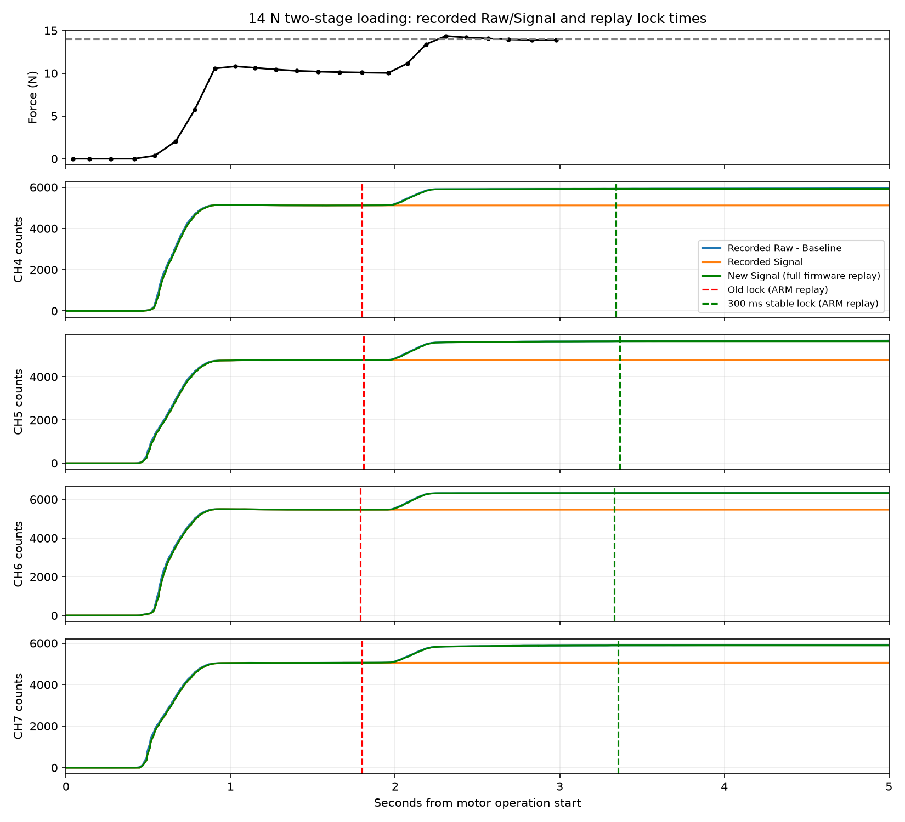

# 14 N两段加载被FLOATING提前锁定

快照为2026-09-20 15:12:46.315895+08:00导出的固定历史记录，实际覆盖15:09:46.323～15:12:46.314。传感器帧26,670条（仅debug/signal计数），其余run_force、统计及温度帧不重复计数。历史缓存完整，最大传感器时间间隔31 ms；所有UART帧序号连续，无传输丢帧证据。

CSV SHA256：`7e8d37d85f5d0847115956a3c4e589bb69f6c2d43981e496660aa4fca44f1df8`，与元数据一致。分析使用固定归档`sensor_data_3min_20260920_151246_315895_741bbe1b.csv`，不把它当作持续更新的实时数据。

## 实测原因

对齐同一时段的新电机日志，快照内有5次14 N目标加载。第一轮15:11:26.801开始：

- 15:11:28.588～28.610：压力约10.08 N，CH4～CH7进入FLOATING。
- 15:11:28.760：电机开始第二段补压，命令-117 step。
- 15:11:29.097：压力约14.50 N；29.818确认稳定到位，约13.85 N。
- 第二段Raw继续上升，但四通道状态始终为FLOATING，Signal保持第一段的值。

| 通道 | 锁定Raw → 启动后4秒Raw | Raw增量 | 实测锁定Signal | 第二段Fast K峰值 |
|---|---:|---:|---:|---:|
| CH4 | 5923 → 6741 | +818 | 5118 | 70.92 %/s |
| CH5 | 5420 → 6306 | +886 | 4765 | 73.50 %/s |
| CH6 | 6244 → 7104 | +860 | 5466 | 75.26 %/s |
| CH7 | 6238 → 7079 | +841 | 5053 | 67.49 %/s |

原逻辑满足“活动至少1秒、Fast稳定、Slow稳定”后仅确认3帧便锁定。FLOATING加压退出要求Fast K至少+80 %/s并连续约50 ms，此次补压未达到门槛。Signal在FLOATING每帧被强制写回锁定值，Raw增量被计入蠕变补偿，因此图上的平线来自算法，不是Raw没有响应，也不是上位机漏刷新。

## 本次修正与验证

选择延后锁定：本轮压力峰值（Raw相对激活Baseline，单位counts）超过300时，连续满足快慢稳定条件300 ms后才提交FLOATING；中途再次加载会清除待确认计数。小压力仍用3帧，保持已验证的轻压抗量化噪声行为。普通RISING/FALLING、FLOATING退出、松手、恢复及Baseline/Signal算法不变。状态运行时仍仅由`channel_state_machine.c::commit_state()`提交。

逐个传感器帧运行真实ARM状态机，不插值、不将其他诊断帧当作采样。旧代码回放能复现原锁定时刻；新代码5轮×4通道均在第二段后才锁定。第一轮新锁定时间15:11:30.131～30.167，约在电机启动3.33～3.37秒后。

再用正式编译的完整食指固件回放第一轮8通道Raw，新Signal为CH4=5924、CH5=5638、CH6=6322、CH7=5888，较实测旧输出分别增加806、873、856、835 counts。完整算法以快照段首Raw进行启动校准，内部历史并非设备重启以来的全部历史，因此这些数值是离线回放结果，不能冒充新固件的实机测量。

29项回归通过：状态机17项、正式三变体固件两段Signal1项、恢复及协议/界面/CSV一致性11项。INDEX_FINGER、THUMB、PINKY各UART/I2C共六套固件编译成功，HEX/CYACD2已更新，未刷入设备。

此修改针对短暂停顿后的连续两段加载。若第一平台持续足够久，仍可能正常锁定；锁定后的缓慢真实加压仍受原退出门槛影响，不能据此声称任意慢变压力都已解决。若后续需要覆盖已锁定后的慢加压，应另用保持/蠕变对照数据验证退出判据。
