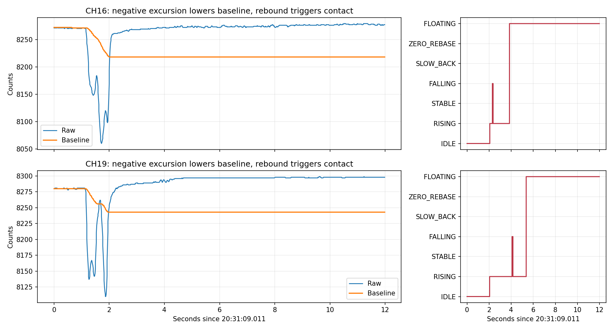

# 2026-09-22：20通道释放后 FLOATING 不退出

本次固定分析已落盘的 20:28:32.126–20:32:10.271 数据，共19505个20通道Debug采样。会话为 `20260922_202813_651538_5abdd762`，使用滚动日志文件00001/00002；分析期间日志还在增长，以下不代表此后状态。日志序号连续，未发现log_gap；这只说明记录队列未报告缺口，不等同于证明设备至串口绝无丢帧。

实际采样端口为COM16。COM4只有开始时一次打开失败。V21，全部20通道属于MatrixButtons0。20:28:59将Nsub从100改为150；最后回读三参数为150/100/30，全部20通道配置与硬件一致。三个命令ACK结果均为0，温度首尾30.4/30.7℃。平均接收89.4 FPS，后段约86–88 FPS，采样接收最大间隔32毫秒；未观察到期间断开。

末尾7路为FLOATING：CH1、2、3、4、6、16、19。其中CH1/2/3/4/16/19连续保持约56–58秒。

|通道|末尾Raw|Baseline|Raw−Baseline|Signal|
|---|---:|---:|---:|---:|
|CH1|8586|8510|76|52|
|CH2|8535|8499|36|35|
|CH3|7929|7848|81|85|
|CH4|8311|8247|64|72|
|CH6|8011|7986|25|35|
|CH16|8273|8218|55|51|
|CH19|8299|8243|56|52|

Signal与Raw−Baseline不同不属于解码错位：现有算法进入FLOATING后冻结Signal并计算蠕变补偿，Baseline也冻结。

## 主要证据：负向变化拉低基线，回弹被判为按压

20:31:10附近，CH19此前Raw/Baseline都约8280。Raw先下降至8110，状态仍IDLE，Baseline追随到8243；Raw回弹，20:31:11.053进入RISING，20:31:14.371进入FLOATING。末尾Raw8299，Baseline仍8243。这56 counts中，有37 counts来自基线被短暂负向波动拉低，并非相对按压前零点的新增信号。

同一事件CH16更明显：此前Raw/Baseline约8273，Raw一度8060，Baseline下移至8218，回弹后误入RISING/FLOATING；末尾Raw已回到约8273，但留下55 counts残差。

这与用户报告的“已释放”一致。负向变化的物理来源（矩阵结构耦合、受力方向或扫描因素）不能仅凭日志确定，但软件吸收负向瞬态、随后误识别回弹的路径已在日志中直接出现。

## 为何不会自行退出

`channel_state_machine.c`：激活门槛12 counts，空闲门槛10 counts；小信号（峰值≤300）快速松手要求峰值回落至少65%，起始Fast K≤−250 %/s，再连续确认约50毫秒。普通低残余回空闲要求≤10 counts，或≤峰值12%且快慢斜率稳定。

`baseline_tracker.c`只在IDLE/RECOVER/ZERO_REBASE追随。FLOATING时保持Baseline不动，而CH16/19的“假按压”是释放回弹产生的上升，后面没有真正下降事件。残差始终大于10，Fast K逐渐接近0，状态可以无限保持。这不靠调低FLOATING→FALLING的−100 %/s门槛解决。

另有正向残余与重复按压情况，例如CH1在20:31:10附近Raw最高8628、Baseline8510，此后Raw约8586。这次可见回落相对118 counts幅度约36%，不足小信号65%的松手比例；此前又已存在冻结基线残余。不能把所有通道归为同一种负向回弹，也不宜只调整一项阈值。

## 另一个独立问题：时基偏快

CH5/8/11/12/15的SLOW_BACK持续3450帧后转ZERO_REBASE，实际耗时约39.4秒；CH6/13/14此前同样3450帧耗时约40.2秒。结合源码30秒超时，推算内部锁定时基为115 Hz，而实际后段接收约86–88 Hz。

源码只在开机或三参数切换后前64帧测量时基，此时处于校准阶段，算法工作量与正式20通道处理不同，符合锁定时基高估的现象。未从芯片读取变量，因此115 Hz是由超时帧数推算值。时基偏差同时影响斜率标度、窗口时长、去抖和恢复速度，需要单独修正；不能把所有延迟当作阈值偏大。

## 建议

1. 优先修正IDLE对短暂负向变化的基线处理：保留按压前可信参考，防止基线吸收短暂负向形变，回弹到该参考附近不能直接成为新按压；持续真实漂移仍须允许跟随。所有判定和状态提交继续集中于channel_state_machine，不在Baseline或上位机另建状态机。
2. 修正实际时基，避免用启动轻负载的64帧代表正式处理帧率。应让计时/斜率对应实际采样间隔，且不能为了刷新时基在持续按压时随意重校准。
3. 在上述修正后，再用轻压持续保持、快速释放、缓慢释放、重复按压回放评估松手65%/−250 %/s门槛。不要直接把OFF阈值从10抬到80或100来吞掉残余，这也会吞掉真实轻压；不要给FLOATING加无条件超时归零，这会把长按清掉。

本次仅诊断和保存分析材料，未修改固件、未烧录、未操作串口。事件复现副本为 `event_203109_203120.jsonl`，SHA256保存在 `summary.json`。
