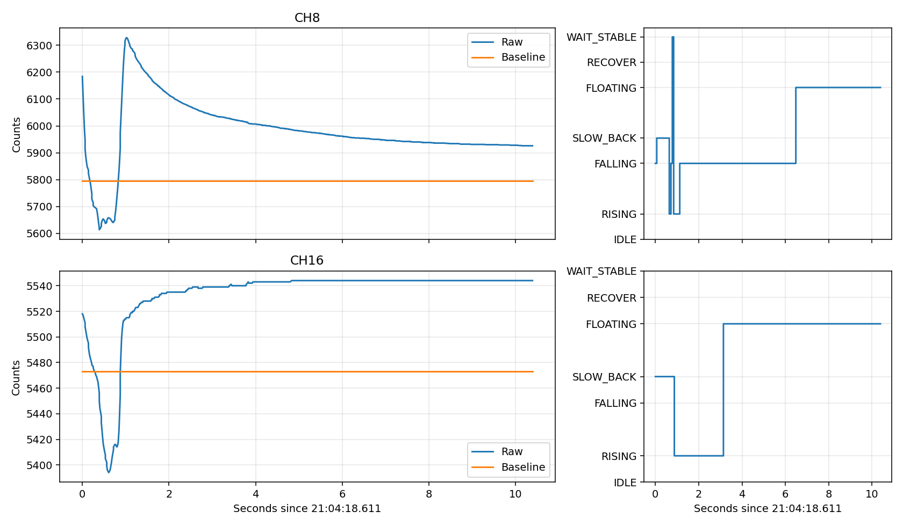

# 新版后仍停留FLOATING：最新日志诊断

本次读取滚动日志00011～00014并固定快照，分析21:01:51重新连接后的COM16数据，截至21:05:18.922。原始记录序号连续，无log_gap；21:01:28～21:01:51为明确断开重连，不当作连续采样。20路三参数回读为200/100/30，配置与硬件一致，ACK成功。采样平均74.35 FPS，重连后最大接收间隔32毫秒。温度约30.4～31.3℃。

新段首个Debug帧21:01:54.609，20路均IDLE，Raw与Baseline相同。用当前编译的真实ARM算法、95 Hz内部时基逐帧回放，从该首帧开始可复现末尾全部20路的State、Baseline、Signal，三者均与日志完全一致。因此这是当前算法可复现的问题，并非界面显示陈旧；协议没有固件构建ID，未通过SWD读取固件身份。

95 Hz来自温度帧间每次恰好95个Debug帧（统计260个间隔），与源码按内部帧率计数触发温度采样相符。实际接收约74 Hz，时基偏差仍存在，但不足以单独解释无限FLOATING。

|通道|末尾Raw|Baseline|残差|Signal|连续FLOATING|
|---|---:|---:|---:|---:|---:|
|CH3|5334|5276|58|45|54.28秒|
|CH8|5895|5796|99|156|53.83秒|
|CH13|5406|5268|138|112|53.14秒|
|CH16|5544|5473|71|64|57.17秒|
|CH18|5416|5351|65|52|52.19秒|

## CH8：回落很多，但下降速度不够，未确认松手

21:04:19.447附近重新激活，回放得到本轮峰值差值532 counts。之后Raw从约6328连续下降，21:04:25.094进入FLOATING时差值约158，Signal锁定156；末尾差值99，较峰值已经下降81.4%。

532处于中压力段，当前插值松手条件要求回落29%（整数向上取整）且近期Fast K达到约−116.29 %/s。该段上报Fast K最低约−87.77 %/s；上报每8帧更新一次，不能单凭遥测断言每帧内部值，但真实ARM回放同样没有确认松手。

普通近零退出还要求差值≤32，或≤峰值12%（约63.8）且稳定。最终99两者均不满足。斜率逐渐变平后，FALLING又进入FLOATING，Baseline和Signal冻结。上一版500毫秒下降证据保留只解决先后达标的问题，不能解决没有合格快速下降证据的慢释放。

## CH16：SLOW_BACK回弹被误认为再次按压

21:04:19.488，Raw=5472、Baseline=5473，状态却由SLOW_BACK进入RISING。这里走的是恢复阶段专用分支：只检查Raw相对最近低谷的增量和正向斜率，没有要求Raw同时超过可信基线的激活门槛。回放保存的低谷为5394，回升已超过40 counts，即使尚低于Baseline也能激活。

此后Raw回弹到5544，新活动周期保持，21:04:21.744进入FLOATING，留下71 counts正差值。这个路径不能用普通IDLE→RISING的40 counts条件解释。

## CH3/13/18：基线恢复或负向跟随后，回升再次越过激活门槛

- CH3反复负向变化时处于IDLE，Baseline被逐步拉低；21:04:22.932，Raw5319、Baseline5276，超过40并满足上升条件后激活，随后持续回升并锁定。
- CH13在21:04:20.327进入RECOVER，Baseline从约5290快速跟随至5267；21:04:20.785返回IDLE时Raw还在回弹。21:04:21.688，Raw5309、Baseline5268，再次激活，最终Raw5406但Baseline冻结在5268。
- CH18在21:04:21.708回到IDLE，Raw5347、Baseline5348；后续Raw继续回升，21:04:24.274以Raw5395、Baseline5351再次激活。

WAIT_STABLE以“相邻帧变化≤2 counts”连续500毫秒判断稳定。在约74 FPS下，缓慢回弹仍可能每秒变化几十到上百counts，却满足这个条件。进入RECOVER后采用快速跟随，容易在回弹尚未结束时完成一个临时零点。上一版只把IDLE系数降低十倍，未改变这些恢复判据。

## 结论与修正方向

上一版修复覆盖旧日志，但没有覆盖本次慢释放和恢复回弹；当前40/32门槛不是唯一问题。

应补充有充分回落证据的慢释放退出路径，并校验部分卸载保持，不能依赖必须出现快速下降；恢复阶段重新激活应同时核对可信参考，不能仅凭离开局部低谷；恢复稳定性应看一段时间内的斜率/范围，避免逐帧变化小就提前恢复、重新触发。持续真实按压不能用FLOATING固定超时清零。

本次只读取日志、运行当前固件离线回放并生成分析，未修改固件、未编译新固件、未操作串口或烧录。快照为 `debug_snapshot.json.gz`，回放为 `replay95.json`，范围和SHA256见 `metadata.json`。
