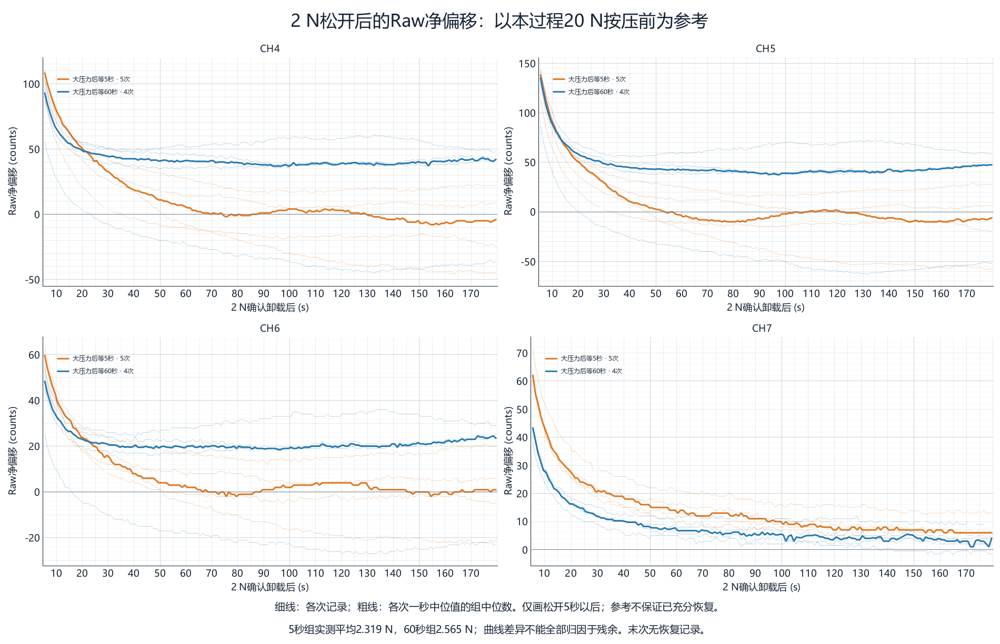

# 20 N之后再压2 N：残差影响复核

来源：`creep_20260915_175554_512_236036da`，2026-09-15T17:55:54.512+08:00 至 2026-09-15T18:30:36.158+08:00。
实际10次小压力按压；前9次有180秒释放后记录，末次释放即结束。加载比较使用10次，释放后比较使用前9次。
原始SQLite SHA256与现有自动报告完全一致，40条通道记录的按压前参考及保持Raw已独立核算一致。

## 主要发现

1. 5秒间隔下，四通道小压力前Raw仍高于本过程20 N按压前参考43～107 counts；60秒间隔为−35～+31.5 counts。它是观测净偏移，可能同时包含残余、慢漂移，不能全部归为纯材料残余。
2. 这份残留相当于本次小压力Raw增量约1.1%～3.7%（各通道组均值），CH4最明显。60秒后明显减小，但正负偏移会抵消，需同时看范围。
3. 5秒组实测力平均2.319 N，60秒组2.565 N，后者高10.6%；两组力范围不重叠。不能据此直接量化同一个真实2 N的残差误差。
4. 所有小压力按压均有明确的RISING和FLOATING记录；保持Signal约2714～5383 counts，按压前Signal中位值均为0。没有看到残差使这批2 N完全无法识别，但Signal有响应不等于测力无偏差。
5. 每组内部Raw增量的标准差/均值约1.0%～2.0%。重复性较好，也存在稳定的组间差异；该差异混合了实际力、加载历史、位移差异和慢漂移。

## 小压力开始前的残留

残留＝小压力前最后1秒Raw中位值－本过程大压力前最后10秒Raw中位值。百分比以本次小压力Raw增量为分母，不是测力误差百分比。

|通道|间隔s|次数|残留均值 counts|残留范围 counts|占本次Raw增量|Raw增量均值 counts|Signal均值 counts|
|---|---:|---:|---:|---:|---:|---:|---:|
|CH4|5|5|100.6|94.0～107.0|3.65%|2756.6|2784.0|
|CH4|60|5|14.9|-17.0～31.5|0.50%|2988.0|2993.4|
|CH5|5|5|75.8|66.0～83.0|2.54%|2988.1|2983.8|
|CH5|60|5|3.9|-35.0～27.0|0.12%|3158.8|3135.0|
|CH6|5|5|50.8|43.0～59.0|1.40%|3635.6|3644.8|
|CH6|60|5|2.6|-16.0～14.0|0.07%|3893.5|3904.8|
|CH7|5|5|58.7|52.0～71.0|1.14%|5125.6|5111.4|
|CH7|60|5|6.3|3.0～9.0|0.12%|5310.0|5309.4|

## 每轮实际压力

|轮次|5秒间隔组 N|60秒间隔组 N|
|---|---:|---:|
|1|2.380|2.630|
|2|2.340|2.580|
|3|2.305|2.570|
|4|2.290|2.535|
|5|2.280|2.510|

实际到位保持约3.000～3.063秒；大压力保持中位力19.67～19.96 N。
小压力到位位置：5秒组−14133～−14145 counts，60秒组−14152～−14155 counts；均不能单凭目标2 N视为等实际加载。

## 为什么报告里有负残差

报告的小压力恢复曲线以“小压力按压前”为零。5秒组这个零点本身仍含大压力残余；释放之后残余继续消退，会出现负数。负数并不自动表示负压力或读数低于最初空载值。
例如第1项CH4：大压力前6927，小压力前7021，偏移+94。小压力释放10秒后，自动报告残差−38，对应Raw=6983，相对大压力前仍为+56 counts。
小压力释放10秒后，统一相对本过程大压力前参考的偏移均值如下。这里同时包含两次按压的历史影响，无法拆分贡献：

|通道|等5秒后再压：释放10秒后 counts|等60秒后再压：释放10秒后 counts|
|---|---:|---:|
|CH4|73.2|58.5|
|CH5|85.0|80.2|
|CH6|40.2|28.0|
|CH7|44.3|27.6|

## 数据质量与结论边界

共17464帧，实际平均约8.39 Hz；记录器报告零丢弃，但源采样存在23个超过250 ms的间隔，最大约625 ms。所有40个保持窗口覆盖检查通过。
第5项小压力前1秒仅4帧，且大压力前参考窗口有间断；其参考可信度稍低。剔除第5项后，5秒组残留均值CH4～7为99.0、74.6、51.1、59.0 counts，结论未改变。
5秒组小压力前CH4/5处于SLOW BACK，CH6多为SLOW BACK，CH7已IDLE；60秒组多数IDLE，第2项CH5为ZERO REBASE。状态不同不阻止本次加载，但会影响参考处理。
温度各按压前代表值约34.9～35.35°C，大压力前参考也随轮次变化。没有独立长时间空载对照，不能把基线变化全部归因于温度或残余。
后续若要量化“同样真实2 N”的残差偏差，应先让两组实际压力落入同一窄范围，并保留到位后真实压力全过程；另加未经历20 N的2 N对照。当前两组实际力无重叠，直接除以力或用线性回归扣除都可能受传感器非线性影响。
当前可确认：等待5秒仍有可重复的残留，等待60秒明显减小；这批2 N均被识别，没有足够证据把全部组间响应差异归为残差或固件阈值问题。

## 图和可复核明细

`press_details.csv`：40条通道明细，含Signal、状态、参考、增量、原始参考下的10秒/60秒偏移。
`group_summary.csv`：按通道与等待间隔分组统计；`audit.json`：源文件SHA256、报告位置和采样质量。
